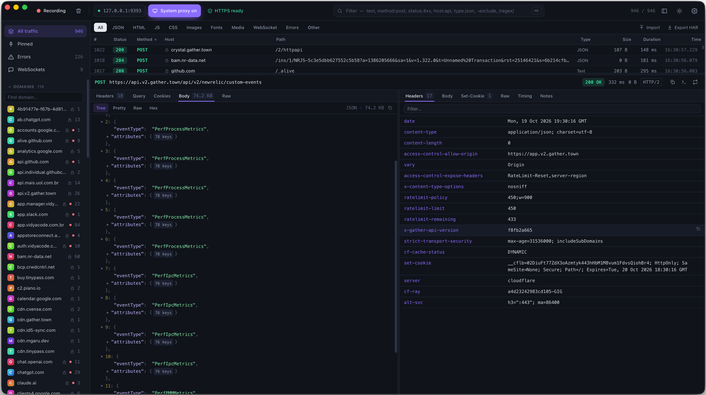
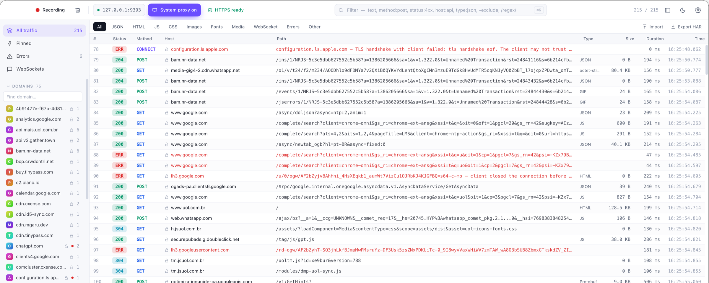
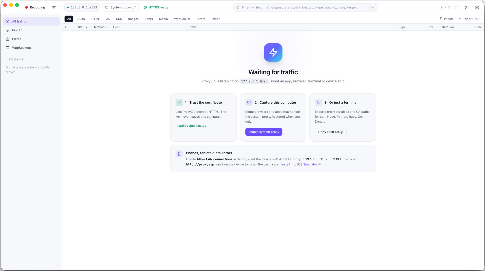
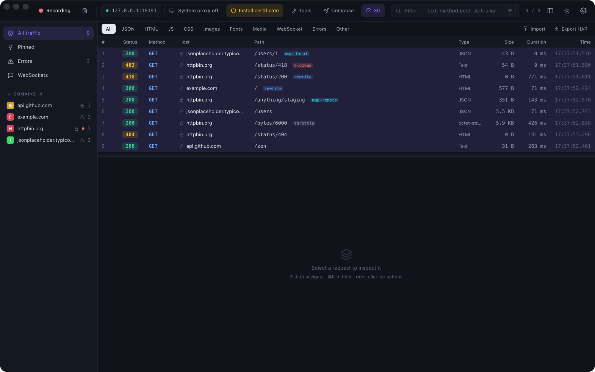
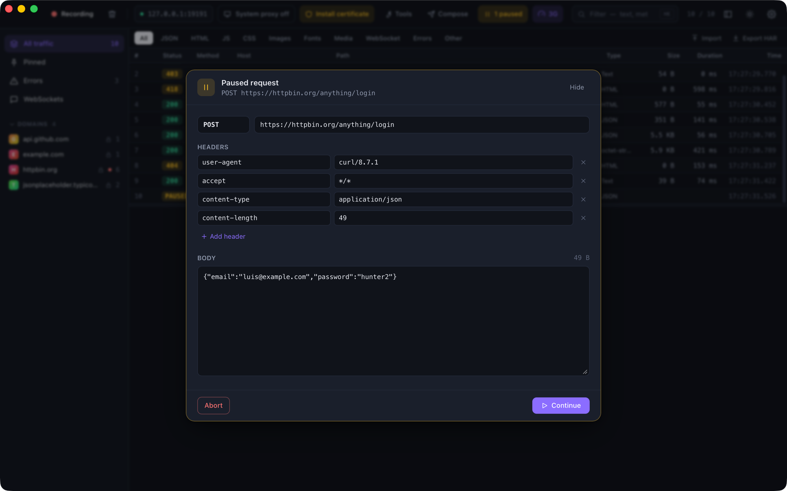
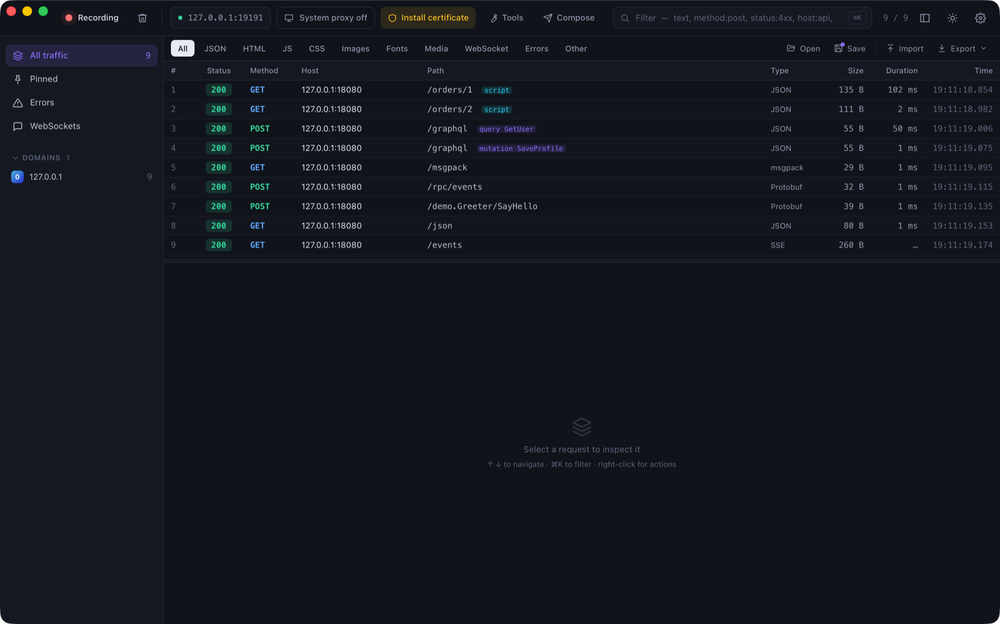

<p align="center">
  
</p>

<h1 align="center">ProxyZip</h1>

<p align="center">
  <b>Capture, inspect and debug the HTTP(S) traffic between your apps and their servers.</b><br />
  A fast, beautiful, open-source debugging proxy written in Rust.
</p>

<p align="center">
  <a href="https://github.com/LuisPeixoto/ProxyZip/actions/workflows/ci.yml"></a>
  <a href="LICENSE"></a>
  <a href="https://github.com/LuisPeixoto/ProxyZip/releases"></a>
  
  
  <a href="CONTRIBUTING.md"></a>
</p>

<p align="center">
  <a href="#install">Install</a> ·
  <a href="#features">Features</a> ·
  <a href="docs/getting-started.md">Getting started</a> ·
  <a href="docs/scripting.md">Scripting</a> ·
  <a href="docs/cli.md">CLI</a> ·
  <a href="docs/architecture.md">Architecture</a> ·
  <a href="docs/roadmap.md">Roadmap</a> ·
  <a href="CONTRIBUTING.md">Contributing</a>
</p>

<p align="center">
  
</p>

ProxyZip sits between an application and the internet, decrypts HTTPS with a certificate authority that lives only
on your machine, and shows you every request, response, header, cookie, body and WebSocket message in real time.
It ships as a native desktop app and as a scriptable command-line tool, and both share the same Rust engine.

## Highlights

- **Everything in the open.** HTTP/1.1, **HTTP/2** and **WebSocket**, with HTTPS decrypted on the fly.
- **Change what happens.** Pause and edit requests, mock responses from disk, redirect hosts, rewrite headers and
  bodies, throttle the network and more, all without touching your code.
- **Fast with huge sessions.** A virtualized list stays smooth with tens of thousands of requests.
- **Made to be understood.** JSON tree, **Protobuf, gRPC, GraphQL, MessagePack** and live **SSE** viewers, jq filters, Diff, timing breakdown, TLS details.
- **Scriptable.** Change requests and responses with a few lines of JavaScript, with a one-click test run.
- **Zero-friction setup.** One click installs the certificate and routes your system through ProxyZip. One command
  does the same for a terminal.
- **Honest errors.** When a client rejects the certificate or a server fails, you get a failed flow with an explanation
  instead of a silent drop.
- **Private by design.** No accounts, no telemetry, no cloud. The CA private key never leaves your computer.
- **Cross-platform.** macOS, Windows and Linux, from one codebase.

## Screenshots

<p align="center">
  
</p>
<p align="center"><sub>Live traffic list: sort, filter and multi-select. Failed requests explain themselves.</sub></p>

<p align="center">
  
</p>
<p align="center"><sub>First run in the light theme: trust the certificate, capture this computer, or just a terminal.</sub></p>

## Features

<table>
  <tr>
    <td width="33%" valign="top">
      <h3>Capture</h3>
      <ul>
        <li>HTTP/1.1, HTTP/2 and WebSocket</li>
        <li>HTTPS interception with a local CA</li>
        <li>Per-host certificates, cached</li>
        <li>SSL proxying include and exclude lists with wildcards</li>
        <li>Excluded hosts are tunnelled untouched (certificate pinning)</li>
        <li>Streaming bodies, with a capped stored copy</li>
        <li><code>SSLKEYLOGFILE</code> output for Wireshark</li>
      </ul>
    </td>
    <td width="33%" valign="top">
      <h3>Inspect</h3>
      <ul>
        <li>Headers, query, cookies and Set-Cookie</li>
        <li>JSON tree, pretty, raw and hex views</li>
        <li>Protobuf, gRPC, GraphQL, MessagePack, SSE</li>
        <li>jq filters and request Diff</li>
        <li>Image and HTML preview</li>
        <li>gzip, deflate, Brotli and Zstandard decoding</li>
        <li>WebSocket message timeline</li>
        <li>Timing: request, TTFB and download</li>
        <li>TLS version, cipher, SNI and ALPN</li>
        <li>Notes on any request</li>
      </ul>
    </td>
    <td width="33%" valign="top">
      <h3>Act</h3>
      <ul>
        <li>Copy as <b>cURL</b>, URL or body</li>
        <li><b>Repeat</b> a request</li>
        <li><b>HAR 1.2</b> import and export, CSV, Postman</li>
        <li>Code in 14 languages</li>
        <li>Save and reopen sessions</li>
        <li>Pin, delete and multi-select</li>
        <li>System proxy on macOS, Windows and Linux</li>
        <li>Certificate install on macOS, Windows, Linux and iOS Simulator</li>
        <li>Phones and emulators over the LAN</li>
        <li>Right-click to set breakpoints, map or block</li>
        <li>Dark and light themes</li>
      </ul>
    </td>
  </tr>
</table>

## Debug and change traffic

Seeing a problem is the first step. Fixing it means changing what the app sends and receives, and ProxyZip lets you
do that without touching your code. Everything lives in **Tools** (`⌘T`), and most of it is one right-click away.

<p align="center">
  
</p>
<p align="center"><sub>Every request shows what happened to it: <code>blocked</code>, <code>map-local</code>, <code>map-remote</code>, <code>rewrite</code>, <code>throttle</code>.</sub></p>

| Tool | What it does |
|------|--------------|
| **Breakpoints** | Pause a request or response, edit method, URL, headers, status and body, then continue or abort |
| **Compose** | Build a request by hand, import a cURL command, or **Edit & repeat** any captured request |
| **Map Local** | Answer from a file or folder on your computer: mock an API in seconds |
| **Map Remote** | Send requests somewhere else: production → staging, API → `localhost` |
| **Rewrite** | Set, add or remove headers and query parameters, change status codes, replace body text |
| **Block** | Return an error status or drop the connection for chosen hosts |
| **Throttling** | Edge, 3G, LTE and poor Wi-Fi presets, or your own latency and bandwidth |
| **DNS overrides** | Resolve any name to any address without editing your hosts file |
| **Upstream proxy** | Chain through an HTTP or SOCKS5 proxy, with authentication and a bypass list |
| **Reverse proxy** | Expose a remote server on a local port and record everything |
| **SOCKS5 listener** | Accept SOCKS5 clients, decrypted and recorded like any other traffic |
| **Record only** | Keep the list focused on the hosts you care about |

<p align="center">
  
</p>

Details and examples are in [Tools](docs/tools.md). The same rules work from the [command line](docs/cli.md) with
`--rules rules.json`.

## Understand and script

<p align="center">
  
</p>

| Feature | What it does |
|---------|--------------|
| **Scripts** | `onRequest` and `onResponse` in JavaScript, with hashing, Base64, JWT helpers and a test button. See [Scripting](docs/scripting.md) |
| **Binary and structured viewers** | Protobuf with descriptor import, gRPC and gRPC-Web, MessagePack, GraphQL, live server-sent events |
| **jq** | Filter any JSON body with a jq expression |
| **Diff** | Compare two requests and their responses side by side |
| **Code** | Generate the request in cURL, Python, JavaScript, Go, Rust, Java, Kotlin, Swift, C#, PHP, Ruby and more |
| **Sessions** | Save and reopen `.pzsession` files, restore the last session, export CSV and Postman collections |

Details are in [Inspecting bodies](docs/inspecting.md) and [Sessions](docs/sessions.md).

## Install

### Desktop app

Download the installer for your platform from the [latest release](https://github.com/LuisPeixoto/ProxyZip/releases):
`.dmg` (macOS), `.msi` / `.exe` (Windows), `.AppImage`, `.deb` or `.rpm` (Linux).

### Build from source

You need [Rust](https://rustup.rs) (stable), [Node.js](https://nodejs.org) 20 or newer and, on Linux, the
[Tauri system dependencies](https://tauri.app/start/prerequisites/#linux) (`libwebkit2gtk-4.1-dev`, `librsvg2-dev`).

```bash
git clone https://github.com/LuisPeixoto/ProxyZip.git
cd ProxyZip/apps/desktop
npm install
npm run tauri dev      # run with hot reload
npm run tauri build    # produce an installer / .app
```

### Command-line only

```bash
cargo install --git https://github.com/LuisPeixoto/ProxyZip proxyzip-cli
proxyzip start
```

## Quick start

1. Open ProxyZip. The proxy starts on `127.0.0.1:9393`.
2. Click **Install certificate** so ProxyZip can decrypt HTTPS.
3. Click **System proxy** to capture the whole computer, or run `eval "$(proxyzip env)"` to capture a single terminal.
4. Use your apps as usual and watch the traffic appear.

More detail, including phones and emulators, is in [Getting started](docs/getting-started.md).

## Filtering

The filter bar understands a small query language:

| You type | It matches |
|----------|------------|
| `login` | URLs containing `login` |
| `method:post` | POST requests |
| `status:4xx` or `status:404` | Status class or exact code |
| `host:api` | Hosts containing `api` |
| `type:json` | Content types containing `json` |
| `-analytics` | Everything that does **not** contain `analytics` |
| `/\/v\d+\/users/` | URLs matching a regular expression |

Terms combine with AND. See [Filtering](docs/filtering.md) for the full reference.

## Keyboard shortcuts

| Shortcut | Action |
|----------|--------|
| `⌘K` / `Ctrl+K` | Focus the filter |
| `⌘E` / `Ctrl+E` | Pause or resume recording |
| `⌘T` / `Ctrl+T` | Open Tools |
| `⌘N` / `Ctrl+N` | Compose a request |
| `⌘S` / `Ctrl+S` | Save the session |
| `⌘O` / `Ctrl+O` | Open a session |
| `⌘D` / `Ctrl+D` | Compare the two selected requests |
| `⌘⇧K` / `Ctrl+Shift+K` | Clear the session |
| `⌘R` / `Ctrl+R` | Repeat the selected request |
| `⌘,` / `Ctrl+,` | Open settings |
| `↑` `↓` `Home` `End` | Move through requests |
| `⌘⌫` / `Delete` | Delete the selection |

## Documentation

| Guide | What is in it |
|-------|---------------|
| [Getting started](docs/getting-started.md) | First capture on a computer, phone or emulator |
| [Certificates](docs/certificates.md) | How the CA works and how to trust it on every platform |
| [Tools](docs/tools.md) | Breakpoints, Map Local and Remote, Rewrite, Throttling and the rest, with the rules file format |
| [Scripting](docs/scripting.md) | The JavaScript API, helpers, limits and examples |
| [Inspecting bodies](docs/inspecting.md) | Viewers, Protobuf and gRPC, jq, Diff and code generation |
| [Sessions](docs/sessions.md) | Save, open and export captures |
| [Command line](docs/cli.md) | Every `proxyzip` command and option |
| [Filtering](docs/filtering.md) | The filter query language |
| [Troubleshooting](docs/troubleshooting.md) | Certificate errors, apps that ignore the proxy, and more |
| [Architecture](docs/architecture.md) | How the engine and the app fit together |
| [Roadmap](docs/roadmap.md) | What is done and what is next |

## Project layout

```
crates/
  proxyzip-core         Flow model, bounded in-memory store, event bus
  proxyzip-proxy        tokio + hyper engine: CONNECT, TLS interception, HTTP/1.1, HTTP/2, WebSocket
  proxyzip-tls          Root CA, per-host certificates, TLS key logging
  proxyzip-rules        Rule model and engine: block, map, rewrite, breakpoints, throttling, DNS and more
  proxyzip-script       QuickJS scripting runtime with time and memory limits
  proxyzip-codec        Content decoding, classification, and the Protobuf, gRPC, MessagePack, SSE, GraphQL and jq viewers
  proxyzip-export       HAR, sessions, CSV, Postman and code generation
  proxyzip-sysproxy     Operating-system proxy settings
  proxyzip-certinstall  Operating-system trust stores
  proxyzip-cli          The `proxyzip` command
apps/desktop
  src-tauri             Tauri 2 shell (Rust)
  src                   Svelte 5 + TypeScript + Tailwind CSS UI
```

## Contributing

Contributions of every size are welcome: bug reports, documentation, UI polish and new protocol support.
Start with [CONTRIBUTING.md](CONTRIBUTING.md) and look for issues labelled
[`good first issue`](https://github.com/LuisPeixoto/ProxyZip/labels/good%20first%20issue).
Please follow the [Code of Conduct](CODE_OF_CONDUCT.md). To report a vulnerability, see [SECURITY.md](SECURITY.md).

## Responsible use

ProxyZip decrypts traffic. Only use it on devices, applications and networks you own or are explicitly authorized to
test, and respect the privacy of anyone whose data you capture.

## License

[MIT](LICENSE) © Luis Peixoto and ProxyZip contributors.
