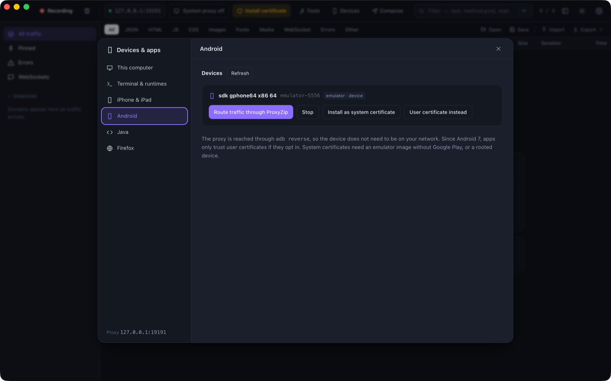

# Devices, browsers and runtimes

Open **Devices** in the toolbar (or **Devices & apps** on the welcome screen) for guided setup. It checks what is
already done and offers a button for each step. Everything here is also available from the command line.

<p align="center">
  
</p>

| Target | In the app | Command line |
|--------|------------|--------------|
| This computer | **This computer** tab | `proxyzip ca install`, `proxyzip system-proxy on` |
| A terminal | **Terminal & runtimes** tab | `eval "$(proxyzip env)"`, `proxyzip terminal` |
| iPhone and iPad | **iPhone & iPad** tab | open `http://proxyzip.cert` on the device |
| iOS Simulator | **iPhone & iPad** tab | `proxyzip ca ios-simulator` |
| Android emulator or device | **Android** tab | `proxyzip ca android` |
| Java | **Java** tab | `proxyzip env` sets `JAVA_TOOL_OPTIONS` |
| Firefox | **Firefox** tab | `proxyzip ca firefox` |

## Terminal and runtimes

`proxyzip env` prints a snippet for your shell (`--shell sh|fish|powershell|cmd`, detected by default) that:

- sets `HTTP_PROXY`, `HTTPS_PROXY`, `NO_PROXY` and their lowercase forms;
- points the certificate variables of curl, Python `requests`, Git, pip, Cargo, the AWS CLI and OpenSSL-based tools
  at a **CA bundle**: the system's trusted roots plus the ProxyZip CA. Using a bundle (not just the ProxyZip CA) means
  hosts you excluded from decryption keep working;
- gives Node.js the CA (`NODE_EXTRA_CA_CERTS`), turns on its native proxy support (`NODE_USE_ENV_PROXY`, Node 24 and
  newer) and preloads a small agent for older versions that tunnels `http` and `https` through the proxy;
- gives Deno the CA, and Java a trust store and proxy options (below).

`proxyzip terminal` (or **Open a terminal** in the app) opens a new terminal window with all of that applied.
Generated files live in `<data folder>/runtime`.

## iPhone and iPad

The device and the computer must be on the same network, and **Allow LAN connections** must be on in Settings.

1. Set the Wi-Fi proxy: *Settings → Wi-Fi → (i) → Configure Proxy → Manual*, with the address and port shown in the app.
2. In Safari open the address shown (or scan the QR code) and tap **iOS profile**. Install it from
   *Settings → Profile Downloaded*.
3. Turn on full trust: *Settings → General → About → Certificate Trust Settings*.

The profile is a standard configuration profile with one root-certificate payload. Remove it any time from
*Settings → General → VPN & Device Management*.

## Android

`proxyzip ca android --list` shows connected emulators and devices. The **Android** tab does the same and adds a
button per step. It uses `adb` from `ANDROID_HOME`, `ANDROID_SDK_ROOT`, the default SDK folders or your `PATH`.

- **Route traffic:** `adb reverse` plus the global HTTP proxy setting, so the device reaches ProxyZip at `127.0.0.1`
  without being on your network. **Stop** (or `--clear-proxy`) undoes it.
- **User certificate:** copies the certificate to the device and opens Android's installer. Works everywhere, but since
  Android 7 apps only trust user certificates if they opt in with a `network_security_config`.
- **System certificate:** for emulators without Google Play and rooted devices. Android 13 and older: the certificate
  is written to `/system/etc/security/cacerts`. Android 14 and newer: it is bind-mounted over the Conscrypt APEX
  store and lasts until the device reboots.

> The Android 14 method follows a widely used procedure but depends on the system image. If it fails, use the user
> certificate or a debug build of your app that trusts user certificates.

## Java

ProxyZip finds your JDK (`JAVA_HOME`, `/usr/libexec/java_home` on macOS, or `java` on the `PATH`), copies its
`cacerts`, and adds the ProxyZip CA with `keytool`. The **Java** tab shows the `JAVA_TOOL_OPTIONS` to use:

```text
-Dhttps.proxyHost=127.0.0.1 -Dhttps.proxyPort=9393 -Djavax.net.ssl.trustStore=…/java-truststore
-Djavax.net.ssl.trustStorePassword=changeit
```

Your JDK is never modified.

## Firefox

Firefox keeps its own certificate store. **Set up Firefox** finds every profile on the computer (macOS, Windows, Linux,
Snap and Flatpak) and

- imports the CA into each profile with `certutil` when it is installed (part of NSS), and
- sets `security.enterprise_roots.enabled` in `user.js`, so Firefox also trusts the operating-system store.

Restart Firefox afterwards, and make sure it uses the system proxy (*Settings → Network Settings → Use system proxy
settings*) or the manual proxy shown in the app.
