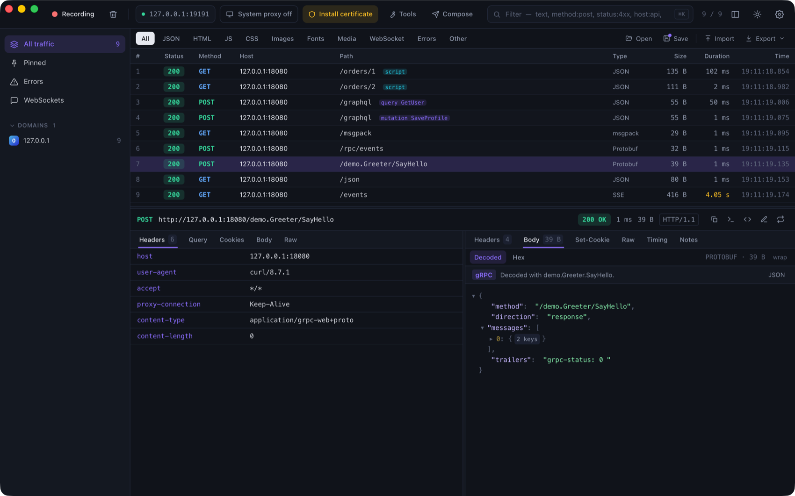
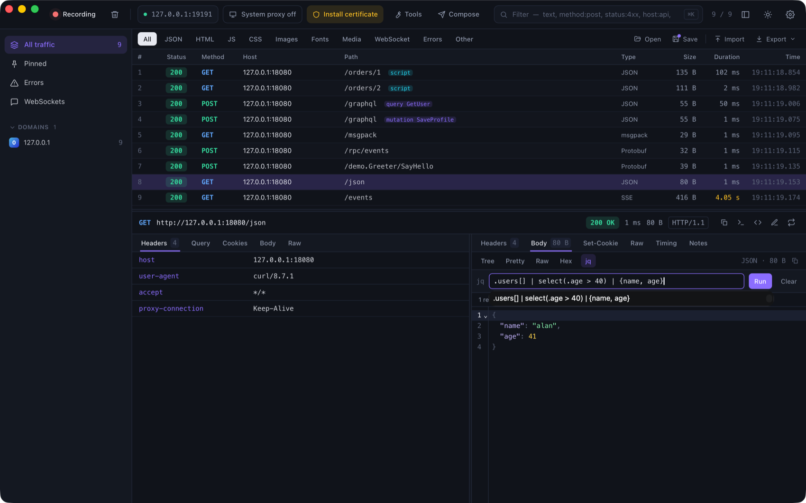
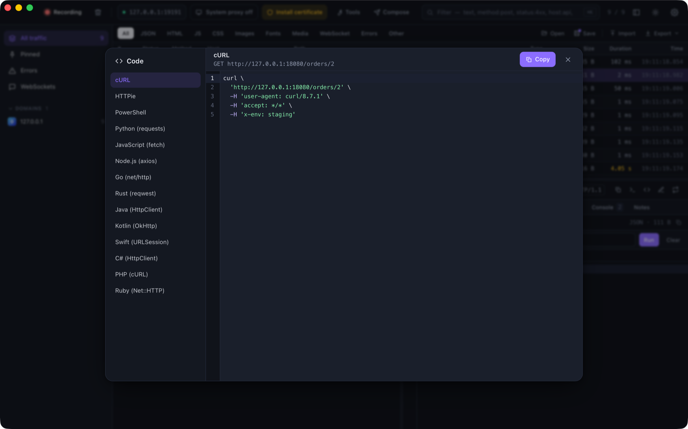

# Inspecting bodies

ProxyZip picks the best view for each body and lets you go deeper when you need to.

## Viewers

| Format | What you get |
|--------|--------------|
| JSON | Collapsible tree, pretty-printed text, raw text |
| XML, HTML, CSS, JavaScript | Syntax-highlighted code with folding and search |
| Images | Preview |
| **GraphQL** | Operation type and name in the list (`query GetUser`), variables and query in the body |
| **Protobuf** | Decoded fields, with or without a schema |
| **gRPC and gRPC-Web** | Frames split, compression flags honoured, messages decoded and trailers shown |
| **MessagePack** | Converted to JSON |
| **Server-sent events** | Parsed into events, updating live while the stream is open |
| Anything else | Hex dump |

<p align="center">
  
</p>

Code views use CodeMirror: search with `⌘F`, fold blocks, wrap long lines. They stay fast with bodies of several
megabytes.

## Protobuf and gRPC

Without a schema ProxyZip decodes the wire format and shows field numbers with their best-guess types. With a schema
you get names and the right types.

1. Compile a descriptor set: `protoc --include_imports --descriptor_set_out=api.desc api.proto`.
2. Open **Tools → Protobuf** and import the `.desc` file.
3. gRPC and gRPC-Web calls are matched automatically from the path (`/package.Service/Method`).
4. For plain protobuf over HTTP, add a mapping from a matcher to a request and a response message type.

<p align="center">
  
</p>

Descriptors are stored in your ProxyZip data folder, so they are available the next time you start.

## jq filters

For JSON bodies, press **jq** in the body toolbar and type a filter. It runs locally, results appear in a code view,
and errors point at the problem. Your recent filters are one click away.

```jq
.users[] | select(.age > 40) | {name, age}
```

<p align="center">
  
</p>

ProxyZip uses [jaq](https://github.com/01mf02/jaq), a jq implementation in Rust, with the standard library, math and
regular expressions.

## Compare two requests

Select two requests and press `⌘D` (or right-click → **Compare the two selected**). The Diff window shows request
and response side by side: start line, headers (sorted, with volatile ones such as `date` and `x-request-id` hidden
by default) and the pretty-printed body.

## Generate code

Press the code button in the inspector, or right-click → **Generate code…**, to get the request as code in:
cURL, HTTPie, PowerShell, Python (requests), JavaScript (fetch), Node.js (axios), Go, Rust (reqwest),
Java (HttpClient), Kotlin (OkHttp), Swift (URLSession), C# (HttpClient), PHP (cURL) and Ruby (Net::HTTP).

<p align="center">
  
</p>

Strings are escaped for each language and binary bodies are sent as Base64. The same generator is available as
[`proxyzip code`](cli.md#proxyzip-code).
