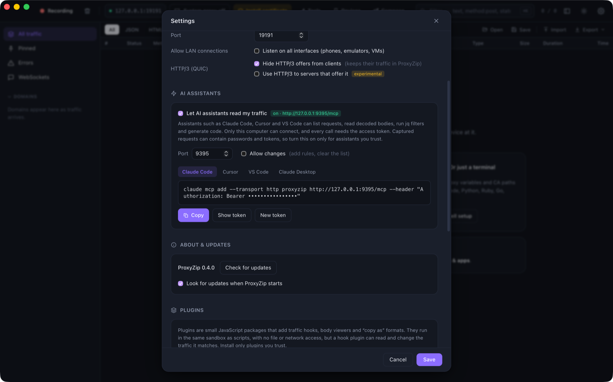

# AI assistants (MCP)

ProxyZip includes a [Model Context Protocol](https://modelcontextprotocol.io) server, so assistants such as Claude
Code, Cursor and VS Code can look at your captured traffic: list and filter requests, read decoded bodies, run jq
filters, generate code and explain what went wrong.

> **Privacy.** Captured requests often contain passwords, cookies and tokens. The server is **off by default**, only
> accepts connections from your own computer, and every call needs an access token. Turn it on only for assistants
> you trust, and remember that their provider receives whatever the assistant reads.

## Turn it on

<p align="center">
  
</p>

**Settings → AI assistants → Let AI assistants read my traffic.** The panel shows a ready-to-copy setup for each
client. The server listens on `http://127.0.0.1:9395/mcp` (the port is configurable) and the token is stored in
`mcp-token` in the data folder (permissions `600`). **New token** invalidates the old one.

| Client | Setup |
|--------|-------|
| Claude Code | `claude mcp add --transport http proxyzip http://127.0.0.1:9395/mcp --header "Authorization: Bearer <token>"` |
| Cursor | `{"mcpServers": {"proxyzip": {"url": "http://127.0.0.1:9395/mcp", "headers": {"Authorization": "Bearer <token>"}}}}` |
| VS Code | `{"servers": {"proxyzip": {"type": "http", "url": "http://127.0.0.1:9395/mcp", "headers": {"Authorization": "Bearer <token>"}}}}` |
| Claude Desktop | `{"mcpServers": {"proxyzip": {"command": "proxyzip", "args": ["mcp"]}}}` (needs the command-line tool) |

## From the command line

```bash
proxyzip mcp                                   # stdio bridge to a running ProxyZip (app or `start --mcp`)
proxyzip mcp --session capture.pzsession       # serve a saved session, read-only
proxyzip start --mcp 9395                      # capture and serve MCP together
proxyzip start --mcp 9395 --mcp-allow-changes  # let assistants edit rules and clear traffic
```

A running ProxyZip publishes its address and token in `mcp.json` in the data folder, which is how `proxyzip mcp` finds
it without any configuration. The file is removed when ProxyZip exits.

## Tools

| Tool | What it does |
|------|--------------|
| `get_status` | Whether ProxyZip is capturing, its address, and how many requests it holds |
| `list_flows` | Requests, newest first, with the [filter](filtering.md) language (`host:api status:5xx -analytics`), paging and order |
| `get_flow` | Headers, decoded bodies (truncated to a limit you choose), timing, TLS, tags and script logs |
| `search_bodies` | Requests whose request or response body contains some text, with a snippet |
| `query_body` | A [jq](inspecting.md#jq-filters) expression on a JSON body |
| `generate_code` | The request as code in any of the [14 languages](inspecting.md#generate-code) |
| `export_har` | Up to 200 requests as HAR 1.2 |
| `list_rules` | The current rules |
| `add_rule`, `remove_rule` | Block, Map Local, Map Remote, Rewrite, script and DNS rules (**changes only**) |
| `clear_flows` | Delete all requests (**changes only**) |

Tools that change anything are refused unless **Allow changes** is on (or `--mcp-allow-changes` is given), and they
say so, so an assistant can tell you what to switch on. `get_flow` bodies are also exposed as resources
(`flow://<id>`).

## Security notes

- The HTTP endpoint binds to `127.0.0.1` only and refuses any other address.
- Requests carrying the `Origin` of a web page are rejected, so a website cannot talk to the server through your
  browser (DNS rebinding).
- Tokens are compared in constant time and never logged.
- The stdio mode (`proxyzip mcp`) runs as your user and reads the same token file, so it needs no extra secret.
