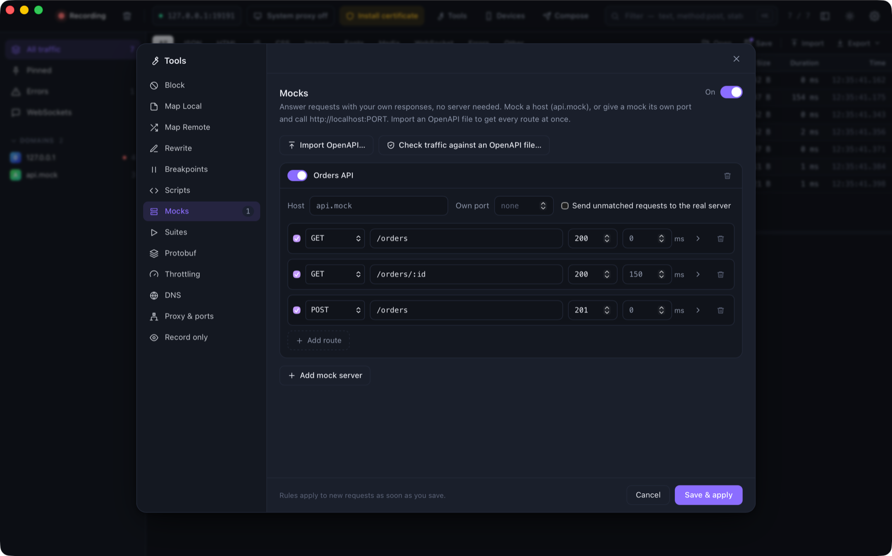

# Mock servers and OpenAPI

A **mock server** is a set of routes that ProxyZip answers itself. Use it when the real API is not built yet, is
unreliable, or you need it to fail in a specific way.

<p align="center">
  
</p>

Open **Tools → Mocks** and add a mock server. There are two ways to reach it:

- **By host.** Give the mock a host such as `api.mock` (wildcards work: `*.mock`, or a real host such as
  `api.example.com`). Requests that go through ProxyZip to that host are answered by the mock.
- **On its own port.** Set **Own port** to 4010 and call `http://localhost:4010/orders`. No proxy settings are needed,
  so any app or test can use it. The request still appears in ProxyZip.

Requests answered by a mock are tagged `mock`. Turning the tool off sends everything to the real servers again.

## Routes

| Field | Meaning |
|-------|---------|
| Method | `GET`, `POST`, … or *ANY* |
| Path | `/users/:id` captures a segment, `*` matches one segment, `/files/**` matches the rest. The query string is ignored |
| Status, delay | What to answer and how long to wait first |
| Body | Text typed in the editor (JSON, XML, anything). The content type is set per route |

The first route that matches wins, so put specific paths before general ones. A request that matches no route gets a
`404` that lists the routes, which makes typos easy to spot. Tick **Send unmatched requests to the real server** to
mock only some endpoints of an API and let the rest through.

## Templates

Tick **Fill in …** on a route and the body (and header values) can use:

| Expression | Value |
|------------|-------|
| `{{params.id}}` | A `:id` segment of the path |
| `{{query.page}}` | A query parameter |
| `{{headers.x-token}}` | A request header |
| `{{body.user.name}}`, `{{body.items.0.id}}` | A field of the JSON request body |
| `{{uuid}}` | A random UUID |
| `{{now}}`, `{{now_unix}}` | The current time, as RFC 3339 or Unix seconds |
| `{{random_int 1 100}}` | A random integer |

Anything unknown renders as an empty string, so a template never fails. Write `\{{` for a literal `{{`.

```json
{ "id": "{{uuid}}", "customer": "{{body.customer}}", "page": {{query.page}} }
```

## From a captured response

Right-click a request → **Create a mock from this response**. ProxyZip adds the route (method, path, status, content
type and body) to a server called **Captured** for that host, with *send unmatched requests to the real server* on, so
the rest of the API keeps working. It is the quickest way to freeze a response and edit it.

## OpenAPI

### Import

**Tools → Mocks → Import OpenAPI…** reads an OpenAPI 3.0 or 3.1 file (YAML or JSON) and creates a mock server with one
route per operation:

- the status is the first `2xx` response;
- the body is the response's `example`, the first of its `examples`, or a value **generated from the schema**
  (required and optional properties, enums, formats such as `date-time`, `uuid` and `email`, minimums and maximums,
  `allOf`, `oneOf`, cyclic `$ref`s);
- `/pets/{petId}` becomes `/pets/:petId`, and literal paths are tried before parameterised ones;
- the mock is bound to the first host in `servers` (including its base path such as `/v1`), so your app talks to the
  mock simply by being captured by ProxyZip.

### Check your traffic against the specification

**Tools → Mocks → Check traffic against an OpenAPI file…** compares captured requests (the selected ones, or all) with
the specification and lists what does not conform. Click a problem to jump to the request; the requests are tagged
`contract-violation`.

| Check | Example message |
|-------|-----------------|
| The path and method are documented | `DELETE is not documented for /pets (documented: GET, POST)` |
| Required parameters are present, values have the right type | `required header parameter X-Trace is missing` |
| A required request body is present and valid | `the request body is required but empty` |
| The status is documented (`200`, `2XX` or `default`) | `status 500 is not documented (documented: 201, 400)` |
| The response body matches its schema | `"seven" is not of type "integer" (at /id)` |

Requests for other hosts, or outside the API's base path, are skipped. Without `servers` in the specification, requests
whose path is not in it are skipped too.

## Command line

```bash
proxyzip mock petstore.yaml --port 4010          # serve a specification as a mock API
proxyzip mock team.pzworkspace                   # serve the mock servers of a workspace
proxyzip validate petstore.yaml capture.pzsession # exits with 1 if anything does not conform
proxyzip validate petstore.yaml capture.har --json
```

`proxyzip mock` prints each request it answers. `validate` is meant for CI: capture traffic from your integration
tests with `proxyzip start --save`, then fail the build when the API drifts from its specification.

Mocks are stored in `rules.json` with the other rules, so they are part of a [workspace](workspaces.md).
