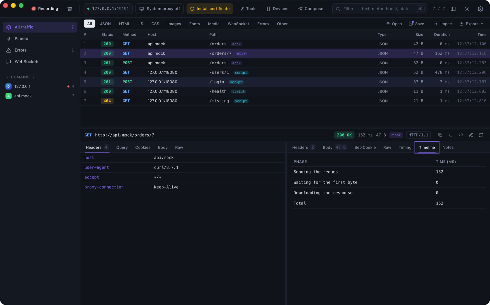

# Plugins

A plugin is a small JavaScript package that extends ProxyZip with **traffic hooks**, **body viewers** and **“copy as”
formats**. It runs in the same sandbox as [scripts](scripting.md): QuickJS, no file, network or process access, 2
seconds and 64 MB per call.

> A plugin with a traffic hook can read and change the requests it matches. Install only plugins you trust.

## Install

**Settings → Plugins → Install from folder…** (or **from .zip…**). Plugins are stored in `<data folder>/plugins/<id>`,
can be switched off without removing them, and a broken plugin is reported without affecting the others.

## Anatomy

```text
my-plugin/
  plugin.json
  main.js
```

```json
{
  "id": "my-plugin",
  "name": "My plugin",
  "version": "1.0.0",
  "description": "What it does",
  "author": "You",
  "api": 1,
  "contributes": {
    "hooks": { "pattern": "api.example.com", "regex": false, "methods": [], "request": true, "response": false },
    "viewers": [{ "id": "custom", "name": "Custom format", "content_types": ["application/x-custom"] }],
    "copy_as": [{ "id": "markdown", "name": "Markdown", "syntax": "text" }]
  }
}
```

`id` uses `a-z`, `0-9`, `.`, `_` and `-`. `api` is the plugin API version the plugin was written for (currently `1`);
a plugin that needs a newer one is refused with a message. Everything under `contributes` is optional. Plugin API 2 adds `settings` and `tabs` (below); API 1 plugins keep working.

## Hooks

Exactly like a script: define `onRequest(ctx, request)` and/or `onResponse(ctx, request, response)` in `main.js`.
`hooks.pattern` is matched against the URL (a regular expression when `regex` is true) and `methods` limits the HTTP
methods. Hooks run together with your own scripts (and obey the **Scripts** switch in Tools). They are never written to
`rules.json`.

```js
function onRequest(ctx, request) {
  request.headers["x-request-id"] = request.headers["x-request-id"] || $.uuid();
  return request;
}
```

## Viewers

A viewer decodes bodies that no built-in viewer understands. `decode(body, info)` receives

- `body`: `{ text, base64 }`. `text` is the UTF-8 text, or `null` for binary data;
- `info`: `{ contentType, url }`;

and returns `{ format, json }` (or `null` to pass). The result appears in the **Decoded** view, with a note naming the
plugin.

```js
function decode(body, info) {
  const jwt = $.jwt.decode(body.text.trim());
  return { format: "jwt", json: { header: jwt.header, payload: jwt.payload } };
}
```

## Copy as

`generate(request)` receives the request (`{ method, url, headers, body, bodyBase64 }`, body decoded) and returns text.
It becomes another tab in the **Code** window, next to the built-in languages.

```js
function generate(request) {
  return "```http\n" + request.method + " " + request.url + "\n```";
}
```

## Settings

A plugin can let the user choose values (API 2). Declare them in `plugin.json`:

```json
"settings": [
  { "key": "name", "label": "Header name", "type": "string", "default": "x-debug" },
  { "key": "retries", "label": "Retries", "type": "number", "default": 3 },
  { "key": "mask", "label": "Mask values", "type": "boolean", "default": true },
  { "key": "mode", "label": "Mode", "type": "select", "options": ["fast", "safe"] }
]
```

**Settings → Plugins → Settings** shows a form, and `main.js` reads the values as `plugin.settings.name`. Hooks pick up
changes immediately. The same `plugin` object has `id`, `name` and `version`.

## Inspector tabs

A plugin can add a tab next to the response's *Body* and *Timing* (API 2):

```json
"contributes": { "tabs": [{ "id": "timeline", "name": "Timeline" }] }
```

```js
function render(flow, info) {
  return { type: "table", content: { columns: ["Phase", "ms"], rows: [["Total", String(flow.timing.finished - flow.timing.started)]] } };
}
```

`flow` has `id`, `request` and `response` (as in scripts, bodies decoded), `timing` (`started`, `request_sent`,
`response_started`, `finished` in milliseconds), `tags`, `client`, `tls` and `error`. The result is one of:

| `type` | `content` |
|--------|-----------|
| `text` | A string |
| `markdown` | A string: headings, lists, code blocks, `**bold**` and `` `code` `` (no HTML) |
| `json` | Any value, shown as a tree |
| `table` | `{ columns: [...], rows: [[...], ...] }` |

<p align="center">
  
</p>

## Catalog

**Settings → Plugins → Browse the catalog** lists the plugins published in the [`plugins`](../plugins) folder of the
ProxyZip repository. Installing downloads the files and checks every one against its SHA-256 in
[`catalog.json`](../plugins/catalog.json); a file that does not match is not installed. Updates are offered when the
catalog has a newer version.

To contribute a plugin, add a folder to `plugins/`, run `python3 plugins/build_catalog.py` to refresh the catalog, and
open a pull request. CI checks that the catalog matches the files.

## Examples

[`plugins`](../plugins) holds the catalog:

| Plugin | What it shows |
|--------|---------------|
| **JWT viewer** | A viewer and a Markdown “copy as” |
| **Request ID** | A hook |
| **Base64 viewer** | A viewer with a setting |
| **Add header** | A hook driven by four settings |
| **Request timeline** | An inspector tab |

They are covered by tests, so they keep working.

## Helpers

The same `$` helpers and `console` as scripts are available: hashing, Base64, JWT decoding, UUIDs and JSON.
`console` output from hooks appears in the flow's **Console** tab.
