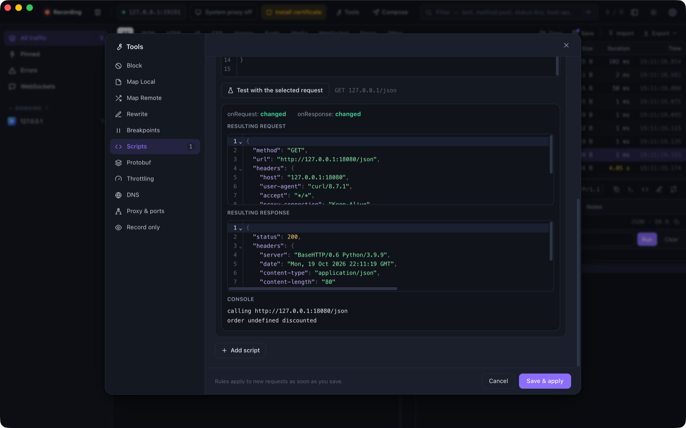

# Scripting

Scripts let you change traffic with a few lines of JavaScript. They run inside the proxy, on every matching request
and response, and need no changes to your app.

<p align="center">
  
</p>

Open **Tools → Scripts**, add a script, choose which requests it matches (the same matcher as every other rule) and
write `onRequest` and/or `onResponse`.

## Hooks

```js
function onRequest(ctx, request) {
  request.headers["x-env"] = "staging";
  return request;
}

function onResponse(ctx, request, response) {
  const data = JSON.parse(response.body);
  data.discounted = true;
  response.body = JSON.stringify(data);
  return response;
}
```

Both hooks are optional. Return the object you received (or nothing, if you edited it in place). Returning `null`
from `onRequest` **blocks** the request: the client receives `403` and the flow is tagged `script`.

| Object | Fields |
|--------|--------|
| `request` | `method`, `url`, `headers`, `body`, `bodyBase64` |
| `response` | `status`, `headers`, `body`, `bodyBase64` |
| `ctx` | `shared`: an object that persists between runs of the same script |

- `headers` is an object. A header that appears more than once is an array. Names keep their original case.
- `body` is the decoded text (compression removed). For binary payloads use `bodyBase64`. Set whichever you change;
  if you set `body`, the length headers are fixed for you.
- Changing `request.url` redirects the request. Changing `response.status` changes what the client sees.

## Helpers

| Helper | Description |
|--------|-------------|
| `console.log`, `console.warn`, `console.error` | Written to the flow's **Console** tab |
| `$.base64.encode(s)`, `$.base64.decode(s)` | Base64 for strings |
| `$.md5(s)`, `$.sha1(s)`, `$.sha256(s)` | Hex digests |
| `$.hmacSha256(key, message)` | Hex HMAC |
| `$.uuid()` | A random UUID v4 |
| `$.jwt.decode(token)` | `{ header, payload, signature }` (does not verify) |
| `$.json.parse(s)`, `$.json.stringify(v, space)` | JSON helpers |
| `$.sleep(ms)` | Delay the request or response |

Scripts are synchronous: `async` functions and `await` are not supported, and a hook that returns a Promise is
reported as an error. There is no network, file or process access.

## Limits and safety

Scripts run on QuickJS in a small pool of worker threads.

- Each run is limited to **2 seconds** and **64 MB** of memory. A script that loops forever is interrupted.
- A script that throws, times out or has a syntax error **never breaks your traffic**. The request continues
  unchanged, the flow is tagged `script-error` and the message is in its Console tab.
- Request scripts run after the other rewrite rules. Response scripts need the whole body, so ProxyZip buffers
  responses that a script matches.

## Testing a script

**Test with the selected request** runs the script against the request you selected in the list and shows the
resulting request, response, console output and any error. Nothing is sent over the network.

## Examples

Add an auth header only to one host:

```js
function onRequest(ctx, request) {
  request.headers["authorization"] = "Bearer " + $.base64.encode("dev-user:dev-pass");
  return request;
}
```

Count calls and log them:

```js
function onRequest(ctx, request) {
  ctx.shared.calls = (ctx.shared.calls || 0) + 1;
  console.log("call #" + ctx.shared.calls, request.method, request.url);
}
```

Mock a failure for every third response:

```js
function onResponse(ctx, request, response) {
  ctx.shared.n = (ctx.shared.n || 0) + 1;
  if (ctx.shared.n % 3 === 0) {
    response.status = 503;
    response.body = JSON.stringify({ error: "try again" });
  }
  return response;
}
```

Scripts are stored in `rules.json` (see [Tools](tools.md#rules-file)) and also run with
`proxyzip start --rules rules.json`.
