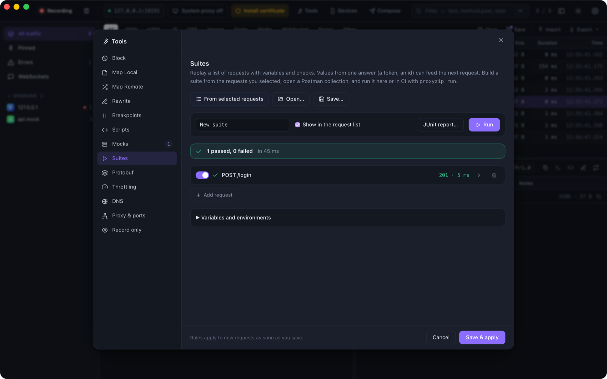

# Replay suites

A **suite** is a list of requests that ProxyZip sends in order, with variables and checks. Values from one answer (a
token, an id) can feed the next request. Run it from the app while you work, or from the command line in CI.

<p align="center">
  
</p>

## Build one

- **From captured requests.** Select requests in the list, right-click → **Add to a suite…** (or **Tools → Suites →
  From selected requests**). Each request expects the status it got when you captured it.
- **From Postman.** **Open…** a Postman collection (v2.1). Folders become name prefixes, variables and bearer or basic
  auth are converted, `{{variable}}` becomes `{{vars.variable}}`, and every request expects a `2xx`.
- **By hand.** **New suite**, then add requests.

Suites are saved as `.pzsuite` files (JSON), which are easy to review and keep in Git.

## Variables and environments

Use `{{vars.name}}` in URLs, headers, bodies and checks. Define them under **Variables and environments**:

```json
{
  "variables": { "base": "https://api.example.com", "user": "ada" },
  "environments": { "staging": { "base": "https://staging.example.com" } }
}
```

An environment overrides variables of the same name (`--env staging`). The other [template](mocks.md#templates)
expressions work too: `{{uuid}}`, `{{now}}`, `{{random_int 1 100}}`.

## Checks

| Check | Example |
|-------|---------|
| Status | `{"type":"status","equals":200}` or `{"type":"status","class":"2xx"}` |
| Header | `{"type":"header","name":"content-type","contains":"json"}` |
| JSON value (jq) | `{"type":"jq","expr":".items | length","equals":3}`; without `equals` the result must be truthy |
| Body text | `{"type":"body_contains","text":"ada"}` |
| Speed | `{"type":"duration_below","ms":500}` |
| OpenAPI | `{"type":"open_api","spec":"api.yaml"}`: the exchange conforms to the specification (path relative to the suite) |

A request with no checks passes when the server answers.

## Passing values on

```json
{ "var": "token", "jq": ".token" }
```

in a request's **Keep for later requests** stores `.token` of its response as `{{vars.token}}` for the next requests.
`{"var":"etag","header":"etag"}` keeps a header. If a value cannot be found, the request fails and says why.

```json
{
  "name": "login",
  "method": "POST",
  "url": "{{vars.base}}/login",
  "body": "{\"user\":\"{{vars.user}}\"}",
  "assertions": [{ "type": "status", "equals": 200 }],
  "extract": [{ "var": "token", "jq": ".token" }]
}
```

## Running

In the app, press **Run**. With **Show in the request list** on, the requests go through ProxyZip, so you can open each
one in the inspector; they are tagged `suite`. **JUnit report…** saves the results as XML.

On the command line:

```bash
proxyzip run checkout.pzsuite --env staging --junit report.xml
proxyzip run postman_collection.json --var base=http://localhost:3000
proxyzip run checkout.pzsuite --via-proxy http://127.0.0.1:9393 --trust-proxyzip-ca
```

| Option | Description |
|--------|-------------|
| `-e, --env <NAME>` | Use an environment of the suite |
| `--var NAME=VALUE` | Set a variable (repeatable) |
| `--via-proxy <URL>` | Send the requests through a running ProxyZip |
| `--trust-proxyzip-ca` | Trust ProxyZip's certificate (HTTPS through the proxy) |
| `--insecure` | Do not verify server certificates |
| `--bail` | Skip the rest after the first failure |
| `--junit <FILE>` | Write a JUnit XML report |
| `--json` | Print the report as JSON |
| `--timeout <SECONDS>` | Per-response timeout (default 30) |

The exit code is `1` when anything fails.

### In GitHub Actions

```yaml
- name: Install ProxyZip
  run: |
    curl -sL https://github.com/LuisPeixoto/ProxyZip/releases/latest/download/proxyzip-X.Y.Z-x86_64-unknown-linux-musl.tar.gz | tar xz
    echo "$PWD/proxyzip-X.Y.Z-x86_64-unknown-linux-musl" >> "$GITHUB_PATH"
- name: API checks
  run: proxyzip run tests/api.pzsuite --env ci --junit report.xml
- uses: actions/upload-artifact@v4
  if: always()
  with: { name: api-report, path: report.xml }
```

Combine it with `proxyzip mock` to test against a mock API, or with `proxyzip validate` to check the contract.
