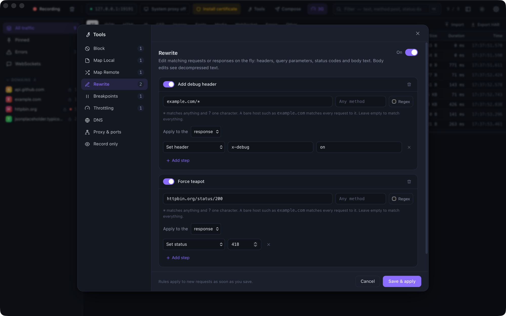
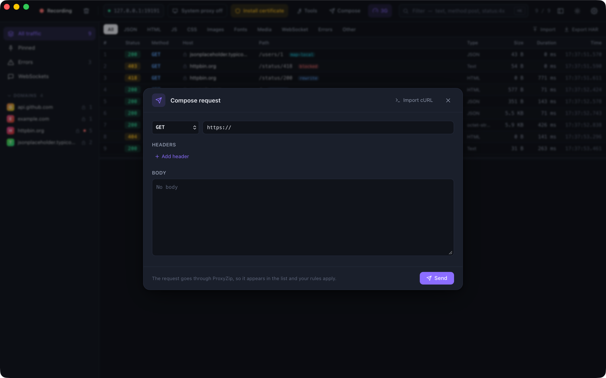

# Tools

Capturing traffic is only half of debugging. The tools below let you **change** what happens to it: answer from disk,
send requests elsewhere, edit them on the fly, slow them down or pause them mid-flight.

Open them from the toolbar (**Tools**, `⌘T` / `Ctrl+T`), or right-click a request for shortcuts that create a rule
for it. Edits are applied when you press **Save & apply** and affect new requests immediately. Every tool has its own
on/off switch, and every rule can be switched off without deleting it.

<p align="center">
  
</p>

- [Matching requests](#matching-requests)
- [Block](#block)
- [Map Local](#map-local)
- [Map Remote](#map-remote)
- [Rewrite](#rewrite)
- [Breakpoints](#breakpoints)
- [Compose and Edit & repeat](#compose-and-edit--repeat)
- [Throttling](#throttling)
- [DNS overrides](#dns-overrides)
- [Upstream proxy](#upstream-proxy)
- [SOCKS5 listener](#socks5-listener)
- [Reverse proxy](#reverse-proxy)
- [Record only](#record-only)
- [PAC file](#pac-file)
- [Rules file](#rules-file)

## Matching requests

Every rule starts with a **matcher**: a URL pattern and an optional list of methods.

| Pattern | Matches |
|---------|---------|
| `example.com` | Every request to that host, on any port and path |
| `example.com:8080` | Only that port |
| `api.example.com/v1/*` | Everything under `/v1/`, scheme ignored |
| `https://api.example.com/*` | Only HTTPS |
| `example.com/login` | Exactly `/login` (a query string is ignored) |
| `*.example.com/*` | Any subdomain |
| *Regex* option, `/users/\d+$` | A case-insensitive regular expression tested against the full URL |

`*` matches any run of characters and `?` matches exactly one. Methods are a comma-separated list (`POST, PUT`);
leave it empty for every method. The first matching rule of a tool wins, so put specific rules above general ones.

## Block

Stop requests from reaching the internet. Respond with an HTTP status (403 by default), or **drop the connection** so
the client sees a network failure, which is handy for testing error handling.

*Quick action:* right-click a request → **Block `<host>`**.

## Map Local

Answer matching requests from your computer instead of the server.

- **Always use this file** serves one file for everything that matches.
- **Look in this folder** picks the file from the part of the URL after the fixed part of the pattern. With
  `example.com/static/*`, the request `/static/js/app.js` is served from `<folder>/js/app.js`, and a path ending in
  `/` serves `index.html`. Paths that try to escape the folder (`..`) are refused.

You can set the status code, extra headers and the `Content-Type` (guessed from the file extension by default).
If the file cannot be read, the client gets a `404` that says why, so a typo is easy to spot.

*Quick action:* right-click a request → **Map Local…**, then choose a file.

## Map Remote

Send matching requests to a different server: production to staging, or an API to `localhost:3000`. Fill in only what
should change.

| Field | Effect |
|-------|--------|
| Scheme, Host, Port | Replace that part of the destination |
| Path | Replaces the whole path. The query string is kept |
| Keep the original `Host` header | Off by default, so the new server sees its own name |

The request in the list shows where it **actually** went, tagged `map-remote`.

*Quick action:* right-click a request → **Map Remote…**.

## Rewrite

Edit requests or responses as they pass through. A rule applies to one **phase** (request or response) and runs its
steps in order.

| Step | Phase | What it does |
|------|-------|--------------|
| Set header | both | Replaces the header, or adds it |
| Add header | both | Appends a header, keeping existing ones |
| Remove header | both | Removes every header with that name |
| Set query parameter | request | Replaces or adds a query parameter |
| Remove query parameter | request | Removes a query parameter |
| Set status | response | Changes the status code |
| Replace in body | both | Replaces text (or a regular expression with `$1` captures) |

Body edits work on the **decompressed text**. A gzip, Brotli or Zstandard body is decoded first and the client then
receives it uncompressed. Binary bodies are never touched. Header-only rewrites keep streaming; a rule that edits the
body has to hold the whole response before sending it.

## Breakpoints

Pause matching traffic, edit it, and let it continue.

When a request (or response) matches, it is held and the **breakpoint editor** opens on its own:

<p align="center">
  
</p>

- **Request:** change the method, URL, headers and body. Changing the URL's host sends the request somewhere else.
- **Response:** change the status, headers and body. You see the real server response before the client does.
- **Continue** sends it on (with your edits, if any). **Abort** closes the client's connection. **Continue all**
  releases everything that is waiting. **Hide** keeps the request paused while you look around; the toolbar shows
  how many are waiting.

A breakpoint rule can pause the request, the response, or both. Breakpoints only trigger while recording is on, and
every paused request is released when the proxy stops.

*Quick action:* right-click a request → **Set breakpoint**.

## Compose and Edit & repeat

**Compose** (`⌘N` / `Ctrl+N`) builds a request from scratch. **Import cURL** fills the form from a cURL command, for
example one copied from your browser's dev tools. **Edit & repeat…** (right-click a request, or the pencil in the
inspector) opens the composer pre-filled with that request.

<p align="center">
  
</p>

Composed requests go through ProxyZip, so they appear in the list and your rules apply to them.

The cURL importer understands `-X`, `-H`, `-d` / `--data-*` / `--data-urlencode`, `--json`, `-u`, `-A`, `-e`, `-b`,
`-G`, `-I`, `--compressed` and `--url`, quoted strings, `$'…'` strings and line continuations. Options that only
change how curl behaves (`-s`, `-k`, `-L`, `-o`, …) are ignored.

## Throttling

Simulate a bad connection.

| Preset | Latency | Download | Upload |
|--------|---------|----------|--------|
| Edge | 400 ms | 240 kbps | 200 kbps |
| 3G | 200 ms | 780 kbps | 330 kbps |
| 4G / LTE | 70 ms | 12 Mbps | 5 Mbps |
| Poor Wi-Fi | 150 ms | 1.5 Mbps | 750 kbps |

Or enter your own numbers (`0` means unlimited). Latency is added once before each request is sent, and the
bandwidth limits pace the request body and the response. By default every request is throttled; add filters to limit
it to some hosts. An active profile is shown in the toolbar.

## DNS overrides

Resolve a host name to an address you choose, without touching your hosts file: `*.example.test → 127.0.0.1`.
Overrides apply to everything ProxyZip connects to, including tunnelled (undecrypted) traffic.

## Upstream proxy

Chain ProxyZip through another proxy, such as a corporate gateway.

- **HTTP** proxies must allow `CONNECT`. Basic authentication is supported.
- **SOCKS5** proxies are supported, with optional username and password.
- **Bypass** lists hosts (wildcards allowed) that connect directly.

The setting applies to new connections. The password is stored in plain text in [`rules.json`](#rules-file).

## SOCKS5 listener

Turn this on to accept SOCKS5 clients as well. Their traffic goes through the same pipeline as proxy traffic:
HTTPS is decrypted, rules apply and everything is recorded. The listener supports no authentication and the
`CONNECT` command. It binds to the same interface as the main proxy, so enable **Allow LAN connections** in
Settings to reach it from other devices.

## Reverse proxy

Expose a server on a local port. With `8081 → https://api.example.com/v1`, a request to
`http://localhost:8081/users` is forwarded to `https://api.example.com/v1/users`, with the `Host` header rewritten, and
recorded. It is the easiest way to debug a client that cannot be configured to use a proxy: just change its base URL.

## Record only

Keep the list focused. When this is on, only requests that match one of the patterns are recorded; everything else is
still proxied normally.

## PAC file

ProxyZip serves a proxy auto-config file that sends traffic to it and everything local direct:

```text
http://127.0.0.1:9393/proxy.pac
http://proxyzip.cert/proxy.pac        (from a device that already uses the proxy)
```

Point a device or browser at one of these as its *automatic proxy configuration* URL.

## Rules file

Rules are stored in `rules.json` in the ProxyZip data folder (see [Certificates](certificates.md#where-the-ca-lives)),
and the CLI can load the same file with `proxyzip start --rules rules.json`. Every field is optional.

```json
{
  "block": [
    { "name": "No trackers", "matcher": { "pattern": "*.tracker.example/*" }, "action": { "type": "status", "code": 403 } }
  ],
  "map_local": [
    {
      "name": "Mock the profile",
      "matcher": { "pattern": "api.example.com/v1/me", "methods": ["GET"] },
      "source": { "type": "file", "path": "/Users/me/mocks/me.json" },
      "status": 200
    }
  ],
  "map_remote": [
    { "name": "Use staging", "matcher": { "pattern": "api.example.com/*" }, "host": "staging.example.com" }
  ],
  "rewrite": [
    {
      "name": "Force a feature flag",
      "phase": "response",
      "matcher": { "pattern": "api.example.com/v1/flags" },
      "ops": [ { "type": "replace_body", "find": "\"newCheckout\": false", "replace": "\"newCheckout\": true" } ]
    }
  ],
  "breakpoints": [
    { "name": "Pause logins", "matcher": { "pattern": "api.example.com/login", "methods": ["POST"] }, "on_request": true, "on_response": false }
  ],
  "throttle": { "enabled": true, "profile": { "name": "3G", "latency_ms": 200, "download_kbps": 780, "upload_kbps": 330 } },
  "dns": [ { "host": "*.example.test", "ip": "127.0.0.1" } ],
  "upstream": { "enabled": true, "kind": "socks5", "host": "127.0.0.1", "port": 1080, "bypass": ["localhost"] },
  "reverse": [ { "listen_port": 8081, "target": "https://api.example.com/v1" } ],
  "socks": { "enabled": true, "port": 9394 },
  "record_only": { "enabled": false, "matchers": [] }
}
```

Each tool also has a switch under `"tools"` (`block`, `map_local`, `map_remote`, `rewrite`, `breakpoints`, `dns`,
`reverse`), for example `"tools": { "rewrite": false }`.
